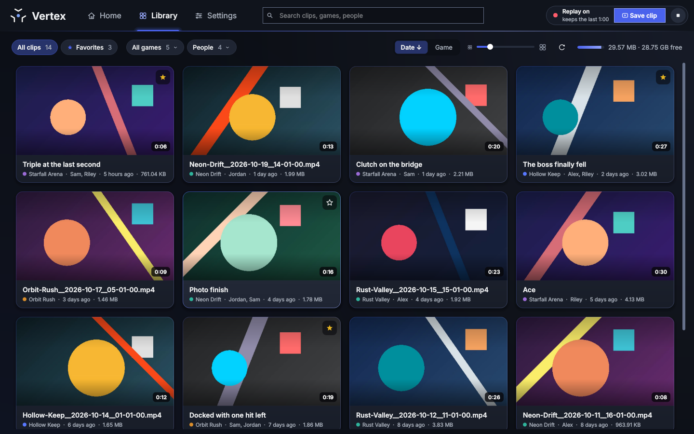
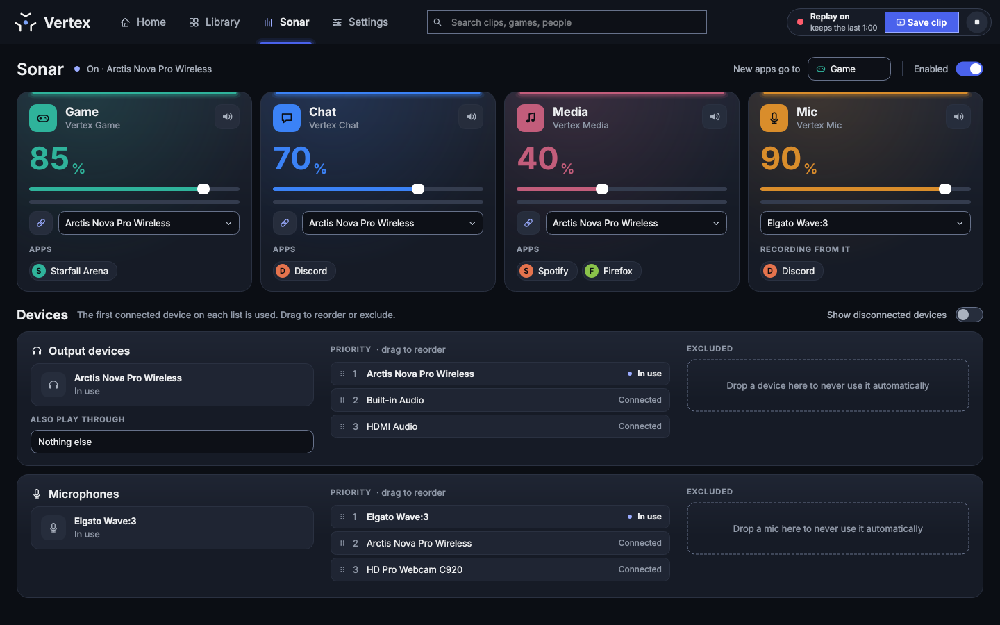
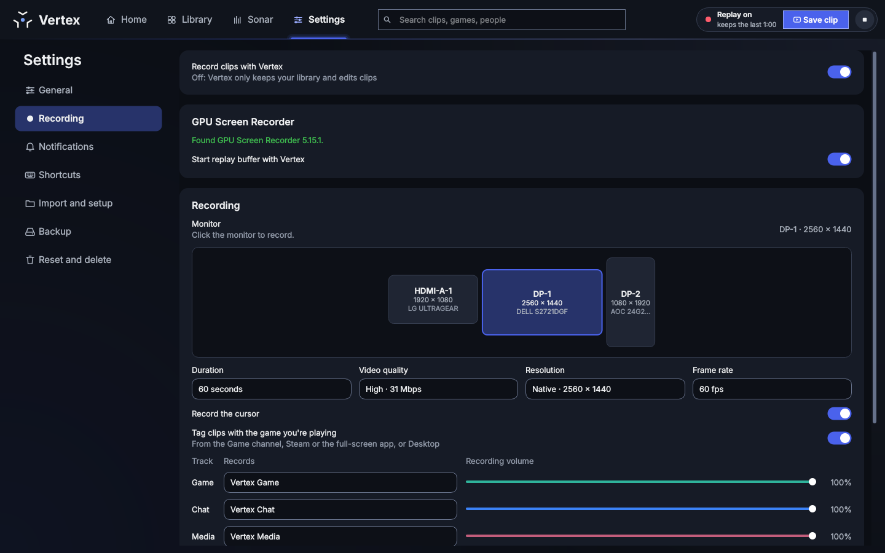
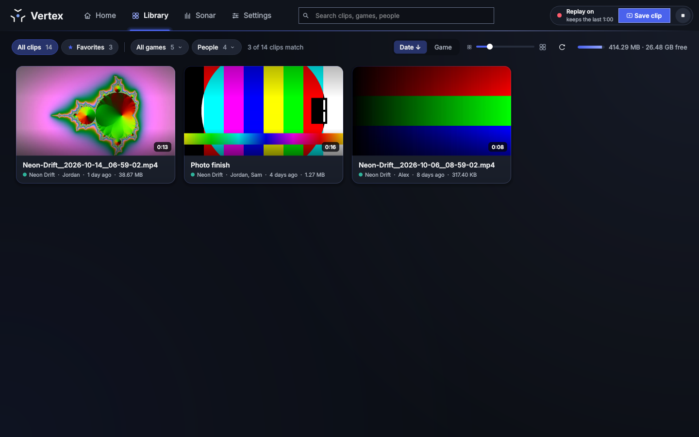
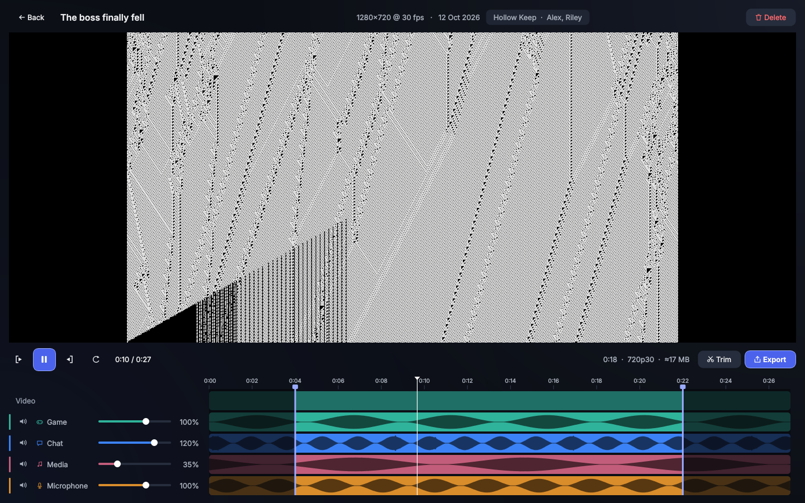
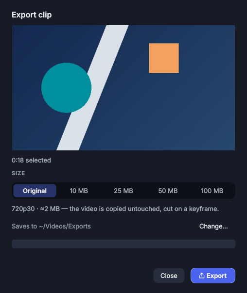
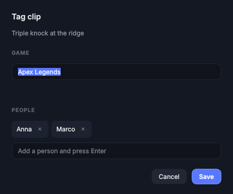
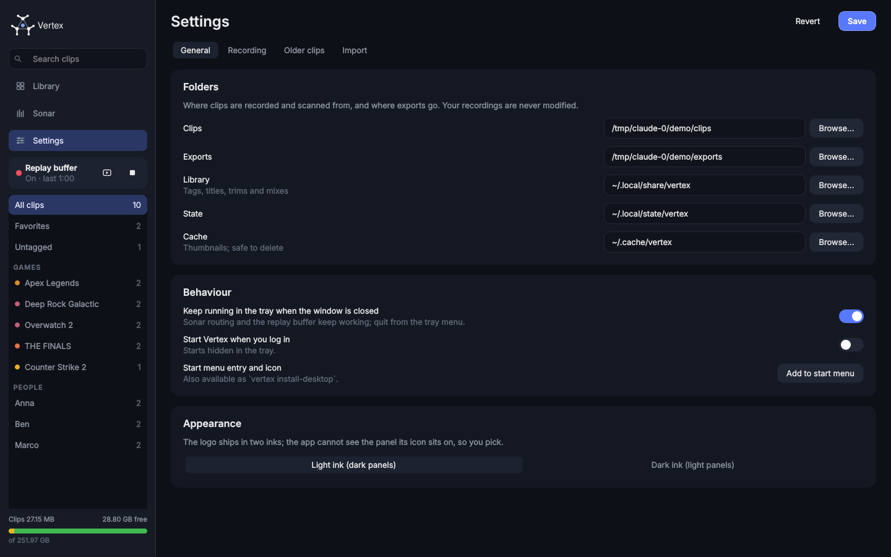

<div align="center">

<picture>
  <source media="(prefers-color-scheme: dark)" srcset="src/vertex/assets/logo/light/vertex-stacked-light.png">
  
</picture>

# **BIG DISCLAIMER AND SOME PERSONAL WORDS**
This entire project is vibe coded. I used Claude Pro to make this entire thing.

I know AI is arse.

I fully acknowledge the ethical, ecological and moral implications that using LLMs bring along with them. Let alone the copyright side of things. 

I know I was using the hard work and the combined 10s of thousands of hours of learning of every **real** and **skilled** developer that is out there. But I was in need of a solution to the only "gripe" I have using Linux. 

I did my switch from Windows to Linux. Getting everything working was pretty easy. Even multi-audio track clip recording was super easy due to GPU Screenrecorder's existence. 

On Windows, I used SteelSeries Moments to capture my gaming clips. Showing them to my friends is super easy. You can adjust the volume or mute audio tracks entirely. I really loved that. You can trim them, and easily export them to discord. Convenient.

But for some reason, no video player supports multi-audio-track playback out of the box. I did some "hacky" things to force my video player to play all audiotracks at once. It worked well.... But I couldnt easily turn down my microphone volume on one audio track, while leaving chat and game sounds at the same volume. So I tried using open source video editors, but I just couldnt get a solid workflow going. It all felt like so much effort to *quickly* edit (trim and adjust volumes per audio track) and share clips to my friends. 

With ongoing microphone issues, I have many clips where my microphone is way too loud. I did eventually fix it, but my historical clips are barely usable due to that fact. 

I use this project for myself. I have about 600 clips that I successfully imported into it. The performance is good. Editing, trimming and sharing works just like it does on the Windows counterpart. 


Talking to one of my friends who is a software developer. He told me the codebase is complete trash. But I should still put it on a Github repo under the MIT license. 

This will most likely be the only code, I will ever publicly share. 

If people are seeing the niche that it tries to cover, take this "project", re-write it, improve it. 

This intro section is written by me, the human behind it. The following showcase of this "project" was also written by AI. I did edit some parts to be more readable. 

**One final note:**

 If you have a gripe with people like me, who vibe code such a thing, thats completely okay. Just dont seek me out and harrass me.

---

**Game clips and Sonar-style audio for Linux — a re-implementation of SteelSeries Moments and Sonar.**

Record the last minute of a game with one key, find any clip in a library of
hundreds, trim it and turn your mic down without touching the game, and send it
to your friends at a size Discord accepts.

</div>

<p align="center">
  
</p>

> **About the screenshots:** every screenshot here comes from a synthetic demo
> library — made-up titles and names, and generated test-pattern footage
> instead of real gameplay.

---

## Contents

- [What it does](#what-it-does)
- [Sonar: the same tracks in every clip](#sonar-the-same-tracks-in-every-clip)
- [Recording](#recording)
- [The library](#the-library)
- [The editor](#the-editor)
- [Trimming and exporting](#trimming-and-exporting)
- [Settings and first run](#settings-and-first-run)
- [Install](#install)
- [Command line](#command-line)
- [Your data](#your-data)
- [How it is put together](#how-it-is-put-together)
- [Thanks](#thanks)
- [License](#license)

---

## What it does

| | |
|---|---|
| **Sonar** | Virtual **Game**, **Chat**, **Media** and **Aux** outputs plus a shared **Vertex Mic**, created on PipeWire. Send each app to a channel once and it stays there; every channel has its own volume and mute. |
| **Recording** | Runs [GPU Screen Recorder](https://git.dec05eba.com/gpu-screen-recorder/about/)'s replay buffer. One hotkey saves the last minute. With Sonar on, every channel is recorded as its own, consistently named track. |
| **Library** | Every clip in your clips folder, with thumbnails, hover previews, games, people, favourites and search. Fast with hundreds of clips. |
| **Editor** | Plays the clip with a live slider per audio track, a waveform per lane, and trim handles. |
| **Sharing** | Lossless trims, and exports sized to fit 10, 25, 50 or 100 MB — then copy the file and paste it straight into a chat. |

One rule holds throughout: **your recordings are never modified.** Titles,
tags, favourites, trim points and per-track volumes live in a small SQLite
library beside them. Vertex has no network access, no telemetry and no account.

---

## Sonar: the same tracks in every clip

<p align="center">
  
</p>

SteelSeries Sonar gives every kind of sound its own virtual device. Vertex does
the same with stock PipeWire/PulseAudio modules:

| Channel | Device apps see | What goes there | Recorded as |
|---|---|---|---|
| Game | **Vertex Game** | Games — and anything without a rule | `Vertex Game` |
| Chat | **Vertex Chat** | Discord, TeamSpeak, Mumble | `Vertex Chat` |
| Media | **Vertex Media** | Spotify, the browser | `Vertex Media` |
| Aux | **Vertex Aux** | Anything you want kept apart | `Vertex Aux` (off by default) |
| Mic | **Vertex Mic** | Your microphone, as one input every chat app can pick | `Vertex Mic` |

- **Routing.** The Applications list shows everything that is playing. Pick a
  channel for an app and the choice is remembered: Vertex moves it there
  whenever it starts playing again.
- **Volumes.** Each channel's fader and mute apply on the way to your headset,
  and follow changes made in your desktop's own sound settings.
- **Your headset.** All channels play through the output you choose. Unplug it
  and they move to another device; plug it back in and they return.
- **Vertex Mic.** Pick it as the input in Discord and friends. It is fed by
  whichever real microphone you choose in Vertex, so swapping mics never means
  touching every app's settings again.
- **In your clips.** Every channel ticked "In clips" becomes its own audio
  track in every recording, titled after the channel. So every clip has the
  same layout — Game, Chat, Media, Mic — and the editor labels the lanes
  without guessing.
- **Leaving no mess.** While Sonar runs, the default channel and Vertex Mic
  become the system defaults; turning Sonar off (or quitting Vertex) removes
  every device and gives the system its previous defaults back. Running it
  twice, or after a crash, never creates duplicates.

---

## Recording

<p align="center">
  
</p>

Vertex uses **GPU Screen Recorder** as its recording backend: it keeps the last
_N_ seconds of your screen in memory (or on disk) and writes them to a clip on
demand, encoded on the GPU so games don't notice. Every recorder option —
capture target, frame rate, codec, quality, bitrate mode, replay length, audio
codec, cursor, and more — is a setting in Vertex, and the Recording page shows
the exact command it will run.

- **Saving a clip.** Bind `vertex save-clip` to a key in your desktop's
  keyboard settings (see [Install](#bind-a-key-to-save-clips)), use **Save
  clip** in the tray menu, or the save button in the rail.
  `vertex save-clip --last 30` saves only the end of the buffer.
- **New clips appear by themselves** in the library, and a notification says so.
- **Automatic game tags.** With Sonar on, a saved clip is tagged with the game
  playing on the Game channel — when exactly one app is playing there.
- **Tracks.** With Sonar on, one track per recorded channel. Without it, the
  tracks you list (default: desktop audio and microphone, separately).
  GPU Screen Recorder 5.15 or newer titles tracks by channel ("Vertex Game");
  older versions title them by device ("Monitor of Vertex Game"), which Vertex
  recognises just the same.

Vertex doesn't need to be the recorder: clips from SteelSeries Moments, older
GPU Screen Recorder setups or anything else dropped into the clips folder are
listed and edited just the same.

---

## The library

<table>
<tr>
<td width="50%"></td>
<td width="50%"></td>
</tr>
<tr>
<td align="center"><b>By game.</b> Every game with its colour and clip count; people get a list of their own.</td>
<td align="center"><b>Search</b> covers game, people, title and file name — every word has to match.</td>
</tr>
</table>

Each card shows a thumbnail (one second in, to skip black intro frames), the
duration, the game and people, the title and the clip's age. Rest the pointer
on a card and it plays a few frames spanning the whole clip. Click the title to
rename it, the tag line to tag it, the star to favourite it; right-click for
the rest (show in folder, copy path, delete to the Trash).

Clips named the SteelSeries Moments way (`Apex-Legends__2026-08-11__22-14-07.mp4`)
are tagged with their game automatically, and spellings are merged so
`THE FINALS` joins an existing `The Finals`. Sort by date or game, either way.

The grid only paints the cards on screen, so a library of hundreds of clips
scrolls as smoothly as one of ten.

---

## The editor

<p align="center">
  
</p>

Click a clip and the editor takes the window. Every audio track gets a lane
with its waveform and a live volume slider (0–150%) — pull the mic down and you
hear it immediately, at the frame you are on. Tracks are named by their Sonar
channel; clips from before Sonar are matched against the capture devices you
name under *Settings → Older clips*, or by their device names.

| Key | |
|---|---|
| Space / click the video | Play / pause |
| ← / → | Seek 5 s (Shift: 1 s) |
| , / . | Step one frame |
| I / O | Set In / Out at the playhead |
| Home / End | Jump to In / Out |
| Double-click the video | Full screen |
| Esc | Back to the library |

Volumes, mutes and trim points are saved per clip as you make them.

---

## Trimming and exporting

<table>
<tr>
<td width="50%"></td>
<td width="50%"></td>
</tr>
</table>

**Trim** cuts the clip to the selection without re-encoding: every audio track
survives at full quality, so a trimmed clip can be edited again. Save it as a
copy, or replace the original (which goes to your Trash; the clip keeps its
name, tags and mix).

**Export** mixes the tracks down at your volumes and writes a shareable MP4.
*Original* copies the video untouched; the capped sizes re-encode with two-pass
x264, stepping the resolution down until the bitrate looks good. When it's done,
**Copy file** puts the file on the clipboard — paste it into Discord or any
upload field.

Trims and exports are written under a hidden name and moved into place when
finished, so a cancelled job leaves nothing behind.

---

## Settings and first run

<table>
<tr>
<td width="50%"></td>
<td width="50%"></td>
</tr>
</table>

First run asks for your clips folder (found by role, so `Vidéos` or `Видео`
work), offers to set up Sonar and the replay buffer, and points at the import
tools. Settings covers folders, running in the tray, starting at login, the
logo ink for your panel, every recorder option, and importing: copy an
existing library (a Moments folder, say) into the clips folder, then review
the games read from its file names before anything is written.

If a configured folder has been renamed or its drive isn't mounted, Vertex says
so before opening the library instead of quietly starting empty.

---

## Install

> **Note:** Vertex is tested on Ubuntu 24.04 (CI) and has been developed
> against PipeWire 1.0. The Arch and Fedora package names below are
> believed to be right but haven't been verified. If one is wrong for your
> distro, please open an issue or a PR.

### 1. System packages

| Needed | Why |
|---|---|
| Python 3.10+ and `pipx` | Vertex itself |
| `ffmpeg` (with `ffprobe`) | thumbnails, waveforms, trims, exports |
| `libmpv` | playback and live mixing |
| `pactl` (PipeWire's pulse server or PulseAudio) | Sonar |
| [GPU Screen Recorder](https://git.dec05eba.com/gpu-screen-recorder/about/) 5.0+ | recording (optional — the library works without it) |

```bash
# Arch
sudo pacman -S python-pipx ffmpeg mpv libpulse
yay -S gpu-screen-recorder            # AUR

# Debian / Ubuntu
sudo apt install pipx ffmpeg libmpv2 pulseaudio-utils libxcb-cursor0

# Fedora (ffmpeg with x264 from RPM Fusion)
sudo dnf install pipx ffmpeg mpv-libs pulseaudio-utils
```

GPU Screen Recorder is also available as a Flatpak
(`com.dec05eba.gpu_screen_recorder`); set its command under
*Settings → Recording → Command* to
`flatpak run --command=gpu-screen-recorder com.dec05eba.gpu_screen_recorder`.
The native package is the tested setup. If whole-screen capture fails on
Wayland, set *Capture* to *Portal*.

### 2. Vertex

```bash
pipx install git+https://github.com/StellarGalaxyAtlas/vertex.git
vertex doctor                         # checks everything above
vertex install-desktop --autostart    # start menu entry, icon, start at login
```

`vertex uninstall-desktop` removes the start-menu entry and autostart again;
`pipx uninstall vertex-clips` removes the program. Neither touches your clips,
library or settings.

### Bind a key to save clips

Desktops bind global shortcuts to commands, so add one that runs
`vertex save-clip`:

- **KDE Plasma:** System Settings → Keyboard → Shortcuts → Add New → Command or Script.
- **GNOME:** Settings → Keyboard → View and Customize Shortcuts → Custom Shortcuts → +.
- **Hyprland / Sway:** `bind = , F9, exec, vertex save-clip` / `bindsym F9 exec vertex save-clip`.

### Upgrading from Vertex 1.x

Your config, library, thumbnails and clips carry over as they are. Remove the
old program first (it lived in its own folder), then install as above:

```bash
cp ~/.local/share/vertex/library.db ~/library.db.backup   # just in case
rm -rf ~/.local/lib/vertex ~/.local/bin/vertex            # the old program only
pipx install git+https://github.com/StellarGalaxyAtlas/vertex.git
vertex install-desktop
```

The library is upgraded in place on first start (it gains two indexes; nothing
is rewritten). One behaviour changed: clips named `Replay_…` are no longer
tagged *Desktop* automatically, because GPU Screen Recorder is now the game
recorder. Tags already on your clips stay as they are.

<details>
<summary>Running from a checkout, for development</summary>

```bash
git clone https://github.com/StellarGalaxyAtlas/vertex.git && cd vertex
python -m venv .venv && source .venv/bin/activate
pip install -e ".[dev]"
vertex                 # or: python -m vertex
pytest                 # see CONTRIBUTING.md
```
</details>

---

## Command line

```
vertex                        open Vertex, or bring the running one forward
vertex --background           start hidden in the tray (what autostart uses)
vertex save-clip [--last N]   save the replay buffer (N = 10/30/60/300/600/1800)
vertex replay start|stop|toggle|status
vertex sonar up|down|status   works without the app running, too
vertex doctor                 check dependencies and settings
vertex install-desktop [--icon light|dark] [--autostart|--no-autostart]
vertex uninstall-desktop
```

---

## Your data

| What | Where |
|---|---|
| Settings | `~/.config/vertex/config.json` |
| Library (tags, titles, trims, mixes) | `~/.local/share/vertex/library.db` |
| Sonar state (the defaults to restore) | `~/.local/state/vertex/sonar.json` |
| Thumbnails and previews | `~/.cache/vertex/` — safe to delete |
| Control socket | `$XDG_RUNTIME_DIR/vertex/control.sock` |

All of these follow the `XDG_*` variables and can be moved in Settings.

---

## How it is put together

Python, split into packages by concern; only `vertex.ui` imports Qt.

| Package | What's in it |
|---|---|
| `vertex.core` | Clips on disk: scanning, file-name parsing, importing, storage |
| `vertex.library` | The SQLite library, with versioned schema migrations |
| `vertex.media` | ffmpeg/ffprobe: probing, mixing graphs, waveforms, trims, exports, thumbnails, track labelling |
| `vertex.audio` | Sonar: the channel definitions, a `pactl` wrapper, and the device/routing manager |
| `vertex.recorder` | GPU Screen Recorder: capability detection, command building, the replay-buffer process |
| `vertex.ui` | The PySide6 application |
| `vertex.cli`, `ipc`, `desktop`, `doctor` | The `vertex` command, its control socket, desktop integration, checks |

[docs/ARCHITECTURE.md](docs/ARCHITECTURE.md) explains the design: threading,
how Sonar is built and kept consistent, how recording and track naming work,
and the data formats. [CONTRIBUTING.md](CONTRIBUTING.md) covers development and
tests.

---

## Thanks

Some more personal words from the human behind the scene. This "project" would have never come alive without projects like the following. I am grateful that there are passionate people out there that create and maintain libraries like this. I am so unbelievably thankful for the open source community. 

### Runtime

- **[GPU Screen Recorder](https://git.dec05eba.com/gpu-screen-recorder/about/)** by dec05eba ·
  *GPL-3.0-only*
  The recording backend: the replay buffer, GPU encoding, and one track per
  audio device. Vertex runs it as a separate program and talks to it through
  its command line and signals.
- **[mpv](https://mpv.io/)** — [github.com/mpv-player/mpv](https://github.com/mpv-player/mpv) ·
  *GPLv2+ / LGPLv2.1+*
  The video playback, and the reason the multi-track mixer is possible at all:
  very few players will mix several audio streams live through a filter graph
  you can swap out mid-playback.
- **[FFmpeg](https://ffmpeg.org/)** — [git.ffmpeg.org](https://git.ffmpeg.org/ffmpeg.git) ·
  *LGPLv2.1+ / GPLv2+*
  Thumbnails, hover previews, waveform peaks, lossless trims and every export.
  `ffprobe` is what tells the app what is inside a clip in the first place.
- **[x264](https://www.videolan.org/developers/x264.html)** — *GPLv2+*
  The two-pass encoder behind every size-capped export.
- **[PipeWire](https://pipewire.org/)** and **[PulseAudio](https://www.freedesktop.org/wiki/Software/PulseAudio/)** —
  the null sinks, loopbacks and remapped sources Sonar is built from, and
  `pactl`, which Vertex drives them with.
- **[Qt](https://www.qt.io/)** — *LGPLv3*
  The toolkit underneath everything on screen.
- **[SQLite](https://sqlite.org/)** — *public domain*
  The whole library. Every edit you make is a row in one file you can copy,
  back up, or open with any tool you like.
- **[Python](https://www.python.org/)** — *PSF License*

### Python packages

- **[PySide6](https://doc.qt.io/qtforpython-6/)** (Qt for Python) — *LGPLv3*
  The official Qt bindings every window and widget is built with.
- **[python-mpv](https://github.com/jaseg/python-mpv)** by jaseg · *GPLv2+ / LGPLv2.1+*
  The ctypes binding to libmpv, including the render API that draws video
  inside the Qt window.
- **[Send2Trash](https://github.com/arsenetar/send2trash)** by Virgil Dupras and
  Andrew Senetar · *BSD-3-Clause*
  Deletes that go to the desktop Trash instead of into the void.

### Prior art

- **SteelSeries Moments** and **SteelSeries Sonar** — the apps Vertex
  re-implements for Linux. The file-naming convention Vertex parses is
  Moments', the export sheet is modelled on its share sheet, and the channel
  layout is Sonar's.
- **[freedesktop.org](https://www.freedesktop.org/)** — the XDG Base Directory,
  Desktop Entry and Trash specifications, which are why the app knows where to
  put its files, how to land in your start menu, and where deleted clips go.

Game titles shown in the screenshots are trademarks of their respective owners
and appear only as example data in a synthetic demo library.

---

## License

[MIT](LICENSE).
