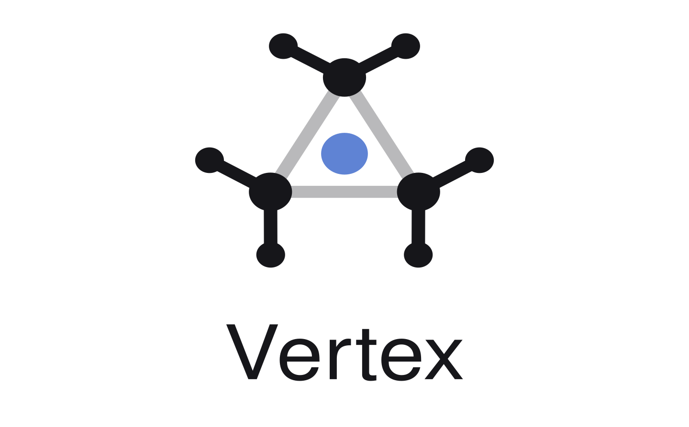

<div align="center">

<picture>
  <source media="(prefers-color-scheme: dark)" srcset="src/vertex/assets/logo/light/vertex-stacked-light.png">
  
</picture>

# **BIG DISCLAIMER AND SOME PERSONAL WORDS**
This entire project is vibe coded. I used Claude Pro to make this entire thing.

I know AI is arse.

I fully acknowledge the ethical, ecological and moral implications that using LLMs bring along with them. Let alone the copyright side of things. 

I know I was using the hard work and the combined 10s of thousands of hours of learning of every **real** and **skilled** developer that is out there. But I was in need of a solution to the only "gripe" I have using Linux. 

I did my switch from Windows to Linux. Getting everything working was pretty easy. Even multi-audio track clip recording was super easy due to GPU Screenrecorder's existence. 

On Windows, I used SteelSeries Moments to capture my gaming clips. Showing them to my friends is super easy. You can adjust the volume or mute audio tracks entirely. I really loved that. You can trim them, and easily export them to discord. Convenient.

But for some reason, no video player supports multi-audio-track playback out of the box. I did some "hacky" things to force my video player to play all audiotracks at once. It worked well.... But I couldnt easily turn down my microphone volume on one audio track, while leaving chat and game sounds at the same volume. So I tried using open source video editors, but I just couldnt get a solid workflow going. It all felt like so much effort to *quickly* edit (trim and adjust volumes per audio track) and share clips to my friends. 

With ongoing microphone issues, I have many clips where my microphone is way too loud. I did eventually fix it, but my historical clips are barely usable due to that fact. 

I use this project for myself. I have about 600 clips that I successfully imported into it. The performance is good. Editing, trimming and sharing works just like it does on the Windows counterpart. 


Talking to one of my friends who is a software developer. He told me the codebase is complete trash. But I should still put it on a Github repo under the MIT license. 

This will most likely be the only code, I will ever publicly share. 

If people are seeing the niche that it tries to cover, take this "project", re-write it, improve it. 

This intro section is written by me, the human behind it. The following showcase of this "project" was also written by AI. I did edit some parts to be more readable. 

**One final note:**

 If you have a gripe with people like me, who vibe code such a thing, thats completely okay. Just dont seek me out and harrass me.

---

**Game clips for Windows and Linux: a re-implementation of SteelSeries Moments.**

Save the last minute of a game with one key, trim it, turn your mic down and
send it to your friends.

</div>

<p align="center">
  
</p>

> The screenshots show a made-up demo library.

---

## Contents

- [Library](#library)
- [Editor and export](#editor-and-export)
- [Recording and notifications](#recording-and-notifications)
- [Settings](#settings)
- [Install](#install)
- [Shortcuts and command line](#shortcuts-and-command-line)
- [Your data and logs](#your-data-and-logs)
- [Thanks](#thanks)
- [License](#license)

Your recordings are never modified. Vertex has no network access, no
telemetry and no account.

---

## Library

<p align="center">
  
</p>

All your clips with previews. Filter by game, person or favorites, search,
tag and rename. A game with a wrong name is renamed from the games menu
(right-click it): its clips are retagged, and new clips get the new name too.

## Editor and export

<table>
<tr>
<td width="60%"></td>
<td width="40%"></td>
</tr>
</table>

A volume slider per audio track, a playback volume (up to 300%, only for
watching), and trimming without quality loss. Share
sizes the clip for Discord and copies it, ready to paste or drag into a chat;
Export saves it in your Exports folder.

## Recording and notifications

<table>
<tr>
<td width="50%"></td>
<td width="50%"></td>
</tr>
</table>

The replay buffer keeps the last minute or two, with game, chat, media and
mic as separate tracks, each recording the device you pick (bring your own
virtual devices to split game and chat). On Windows it records with OBS Studio,
at the volume set for each track:
Vertex starts OBS in the tray and sets up an OBS profile and scene of its
own, both called Vertex, leaving your others alone. A clip saved there is
tagged with the game filling the screen, or Desktop. On Linux it records with
GPU Screen Recorder, and notifications can show over games.

## Settings

<p align="center">
  
</p>

Nine color schemes, recording options, hotkeys, importing
from Moments or Medal (including the folder per game, leaving out any folder
you untick), and resets. Vertex reads the game and the date from clip names:
add each app that recorded them (Medal, ShadowPlay, Xbox Game Bar, OBS and
more), or mark up one of your own names to teach it. A name the first app
can't read goes to the next.

---

## Install

> [!CAUTION]
> **These install steps were written by AI and have not been verified.**
> Vertex has only been used for real on one KDE Plasma (Wayland) setup with
> PipeWire, and not yet on Windows. Read each command before you run it, and
> please open an issue if something is wrong.

### Windows 10 and 11

**1. Programs:** Python 3.10+, FFmpeg, libmpv and, for recording, OBS
Studio 30 or newer. In PowerShell:

```powershell
winget install Python.Python.3.12 Gyan.FFmpeg OBSProject.OBSStudio
```

Open OBS once to get past its first-run wizard, then close it: Vertex
switches on OBS's WebSocket server and starts OBS itself.

libmpv has no winget package: download a `mpv-dev-x86_64` archive from
[mpv's Windows builds](https://sourceforge.net/projects/mpv-player-windows/files/libmpv/)
and put `libmpv-2.dll` in a folder on your `PATH`.

**2. Vertex:**

```powershell
pip install pipx
pipx ensurepath   # then open a new PowerShell window
pipx install git+https://github.com/StellarGalaxyAtlas/vertex-windows.git
vertex            # adds itself to the Start menu and runs setup
vertex doctor     # checks that everything is in place
```

Update with the same install line plus `--force`, then quit Vertex from the
tray and open it again. `vertex uninstall-desktop` removes the Start menu
shortcut and autostart, then `pipx uninstall vertex-clips` removes Vertex;
your clips, library and settings stay.

### Linux

**1. System packages:** Python 3.10+ and `pipx`, `ffmpeg`, `libmpv`, and
optionally [GPU Screen Recorder](https://git.dec05eba.com/gpu-screen-recorder/about/)
(for recording) and `gpu-screen-recorder-notification` (for notifications
over games).

```bash
# Arch
sudo pacman -S python-pipx ffmpeg mpv
yay -S gpu-screen-recorder gpu-screen-recorder-notification   # AUR

# Debian / Ubuntu
sudo apt install pipx ffmpeg libmpv2 libxcb-cursor0

# Fedora (ffmpeg from RPM Fusion)
sudo dnf install pipx ffmpeg mpv-libs
```

**2. Vertex:**

```bash
pipx install git+https://github.com/StellarGalaxyAtlas/vertex-windows.git
vertex            # adds itself to your start menu and runs setup
vertex doctor     # checks that everything is in place
```

Update and remove it as on Windows. For the Flatpak GPU Screen Recorder, set
*Settings › Recording › Advanced › Command* to
`flatpak run --command=gpu-screen-recorder com.dec05eba.gpu_screen_recorder`.

---

## Shortcuts and command line

On Windows, *Settings › Shortcuts* sets hotkeys for saving a clip (or its
last part), starting or stopping the replay buffer and showing Vertex:
click a field and press the keys. They work in games too, while Vertex
runs.

Vertex is also driven from outside by the `vertex` command, for mouse or
keyboard software and scripts (on KDE, bind `vertex save-clip` in System
Settings › Keyboard › Shortcuts › Add New › Command or Script). *Settings ›
Shortcuts* lists every command, ready to copy:

```
vertex save-clip [--last N]       save the replay buffer (or its last N seconds)
vertex replay start|stop|toggle
vertex show | state | watch | doctor
```

The tray menu can show Vertex, save clips and start the replay buffer.

---

## Your data and logs

| What | Windows | Linux |
|---|---|---|
| Settings | `%APPDATA%\Vertex\config.json` | `~/.config/vertex/config.json` |
| Library | `%LOCALAPPDATA%\Vertex\Library\library.db` | `~/.local/share/vertex/library.db` |
| Logs | `%LOCALAPPDATA%\Vertex\State\logs\` | `~/.local/state/vertex/logs/` |
| Thumbnails | `%LOCALAPPDATA%\Vertex\Cache\` (safe to delete) | `~/.cache/vertex/` (safe to delete) |

The logs (`vertex`, `recorder`, `clips`) are small text files for
when something goes wrong; *Keep logs* in Settings switches them off.
Developers: see [docs/DEVELOPMENT.md](docs/DEVELOPMENT.md).

---

## Thanks

Some more personal words from the human behind the scene. This "project" would have never come alive without projects like the following. I am grateful that there are passionate people out there that create and maintain libraries like this. I am so unbelievably thankful for the open source community. 

### Runtime

- **[GPU Screen Recorder](https://git.dec05eba.com/gpu-screen-recorder/about/)** by dec05eba ·
  *GPL-3.0-only*
  The recording backend on Linux: the replay buffer, GPU encoding, and one
  track per audio device. Vertex runs it as a separate program and talks to it
  through its command line and signals.
- **[OBS Studio](https://obsproject.com/)** — [github.com/obsproject/obs-studio](https://github.com/obsproject/obs-studio) ·
  *GPL-2.0-or-later*
  The recording backend on Windows. Vertex drives its replay buffer over
  obs-websocket, and keeps a profile and scene of its own in it.
- **[mpv](https://mpv.io/)** — [github.com/mpv-player/mpv](https://github.com/mpv-player/mpv) ·
  *GPLv2+ / LGPLv2.1+*
  The video playback, and the reason the multi-track mixer is possible at all:
  very few players will mix several audio streams live through a filter graph
  you can swap out mid-playback.
- **[FFmpeg](https://ffmpeg.org/)** — [git.ffmpeg.org](https://git.ffmpeg.org/ffmpeg.git) ·
  *LGPLv2.1+ / GPLv2+*
  Thumbnails, hover previews, waveform peaks, lossless trims and every export.
  `ffprobe` is what tells the app what is inside a clip in the first place.
- **[x264](https://www.videolan.org/developers/x264.html)** — *GPLv2+*
  The two-pass encoder behind every size-capped export.
- **[Qt](https://www.qt.io/)** — *LGPLv3*
  The toolkit underneath everything on screen.
- **[SQLite](https://sqlite.org/)** — *public domain*
  The whole library. Every edit you make is a row in one file you can copy,
  back up, or open with any tool you like.
- **[Python](https://www.python.org/)** — *PSF License*

### Python packages

- **[PySide6](https://doc.qt.io/qtforpython-6/)** (Qt for Python) — *LGPLv3*
  The official Qt bindings every window and widget is built with.
- **[python-mpv](https://github.com/jaseg/python-mpv)** by jaseg · *GPLv2+ / LGPLv2.1+*
  The ctypes binding to libmpv, including the render API that draws video
  inside the Qt window.
- **[Send2Trash](https://github.com/arsenetar/send2trash)** by Virgil Dupras and
  Andrew Senetar · *BSD-3-Clause*
  Deletes that go to the desktop Trash instead of into the void.

### Prior art

- **SteelSeries Moments** — the app Vertex re-implements. The file-naming
  convention Vertex parses is Moments', and the export sheet is modelled on
  its share sheet.
- **[freedesktop.org](https://www.freedesktop.org/)** — the XDG Base Directory,
  Desktop Entry and Trash specifications, which are why the app knows where to
  put its files, how to land in your start menu, and where deleted clips go.

---

## License

[MIT](LICENSE).
