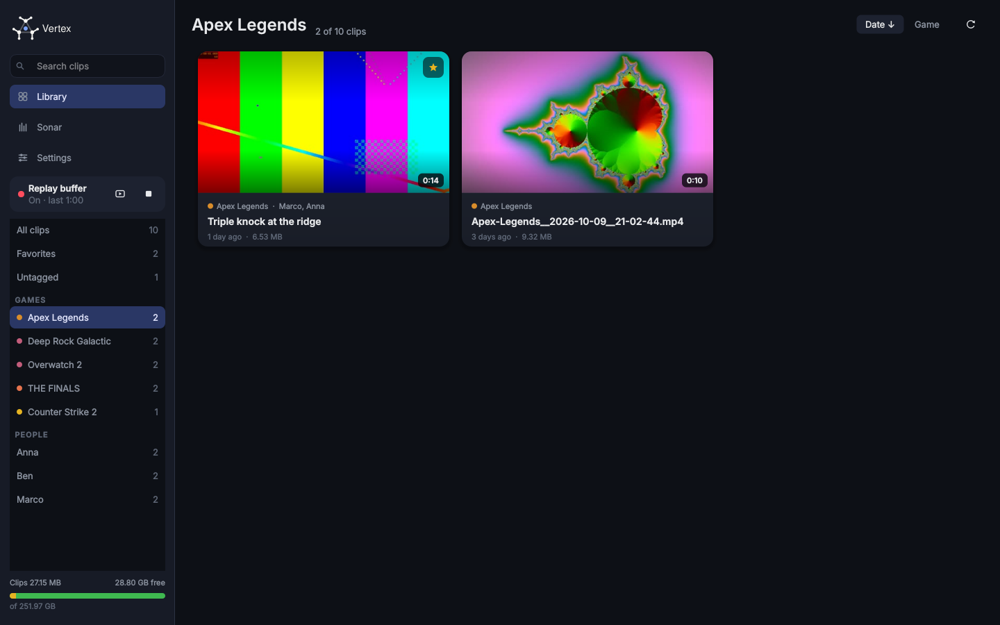
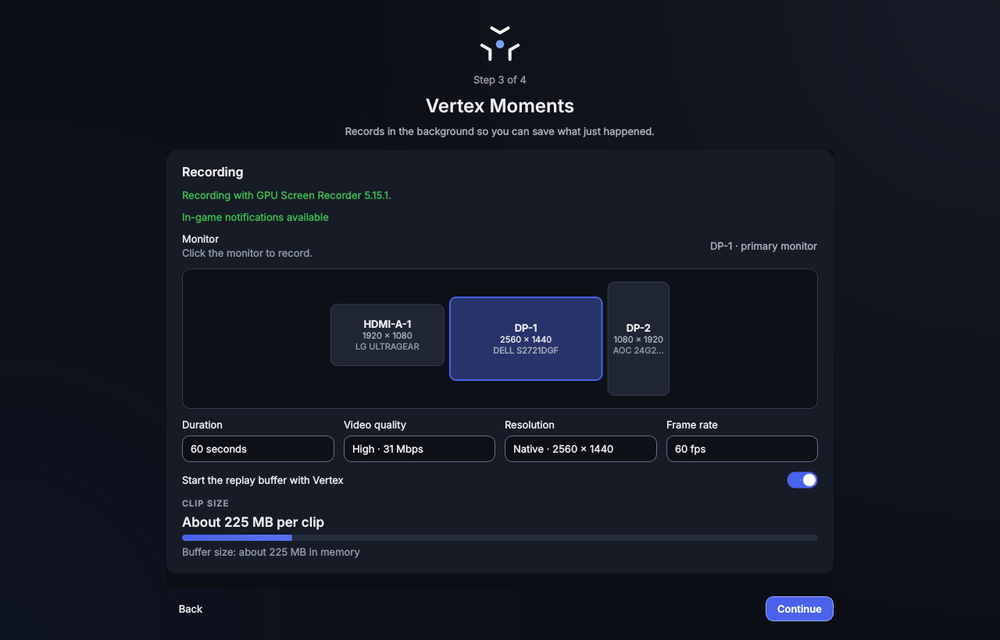

<div align="center">

<picture>
  <source media="(prefers-color-scheme: dark)" srcset="src/vertex/assets/logo/light/vertex-stacked-light.png">
  
</picture>

# **BIG DISCLAIMER AND SOME PERSONAL WORDS**
This entire project is vibe coded. I used Claude Pro to make this entire thing.

I know AI is arse.

I fully acknowledge the ethical, ecological and moral implications that using LLMs bring along with them. Let alone the copyright side of things. 

I know I was using the hard work and the combined 10s of thousands of hours of learning of every **real** and **skilled** developer that is out there. But I was in need of a solution to the only "gripe" I have using Linux. 

I did my switch from Windows to Linux. Getting everything working was pretty easy. Even multi-audio track clip recording was super easy due to GPU Screenrecorder's existence. 

On Windows, I used SteelSeries Moments to capture my gaming clips. Showing them to my friends is super easy. You can adjust the volume or mute audio tracks entirely. I really loved that. You can trim them, and easily export them to discord. Convenient.

But for some reason, no video player supports multi-audio-track playback out of the box. I did some "hacky" things to force my video player to play all audiotracks at once. It worked well.... But I couldnt easily turn down my microphone volume on one audio track, while leaving chat and game sounds at the same volume. So I tried using open source video editors, but I just couldnt get a solid workflow going. It all felt like so much effort to *quickly* edit (trim and adjust volumes per audio track) and share clips to my friends. 

With ongoing microphone issues, I have many clips where my microphone is way too loud. I did eventually fix it, but my historical clips are barely usable due to that fact. 

I use this project for myself. I have about 600 clips that I successfully imported into it. The performance is good. Editing, trimming and sharing works just like it does on the Windows counterpart. 


Talking to one of my friends who is a software developer. He told me the codebase is complete trash. But I should still put it on a Github repo under the MIT license. 

This will most likely be the only code, I will ever publicly share. 

If people are seeing the niche that it tries to cover, take this "project", re-write it, improve it. 

This intro section is written by me, the human behind it. The following showcase of this "project" was also written by AI. I did edit some parts to be more readable. 

**One final note:**

 If you have a gripe with people like me, who vibe code such a thing, thats completely okay. Just dont seek me out and harrass me.

---

**Game clips and Sonar-style audio for Linux: a re-implementation of SteelSeries Moments and Sonar.**

Save the last minute of a game with one key, find any clip in a library of
hundreds, trim it and turn your mic down without touching the game, and send
it to your friends at a size Discord accepts.

</div>

<p align="center">
  
</p>

> **About the screenshots:** they all come from a made-up demo library:
> invented games and names, and generated test patterns instead of gameplay.

---

## Contents

- [What it does](#what-it-does)
- [A quick tour](#a-quick-tour)
- [Install](#install)
- [Command line and Stream Deck](#command-line-and-stream-deck)
- [Your data](#your-data)
- [Documentation](#documentation)
- [Thanks](#thanks)
- [License](#license)

---

## What it does

| | |
|---|---|
| **Home** | Your newest clips, Sonar's faders, your games, the people you play with and the disk space left, on one page. |
| **Library** | Every clip in your clips folder, with thumbnails, hover previews, games, people, favorites and search. Fast with hundreds of clips. |
| **Editor** | A live volume slider and waveform per audio track, trim handles, and lossless trims. |
| **Sharing** | Exports sized to fit 10, 25, 50 or 100 MB, copied to the clipboard to paste into Discord. Quick export straight from a clip's menu, or drag a card out of the window. |
| **Vertex Moments** | Runs [GPU Screen Recorder](https://git.dec05eba.com/gpu-screen-recorder/about/)'s replay buffer. One key saves the last minute; every Sonar channel is its own audio track. |
| **Vertex Sonar** | Virtual **Game**, **Chat** and **Media** outputs and a shared **Vertex Mic** on PipeWire, each with its own volume, mute and level meter. Apps stay on the channel you gave them; a priority list decides which headset and mic are used. |
| **Notifications** | Over fullscreen games through GPU Screen Recorder's notifier, or as desktop pop-ups. Each kind can be switched off. |
| **Control** | A `vertex` command for every action (save a clip, volumes, mutes, devices) to bind to keys, a control socket for scripts, and a [StreamController](https://github.com/StreamController/StreamController) plugin for Stream Deck. |
| **Looks** | Nine color schemes, two of them light. |

One rule holds throughout: **your recordings are never modified.** Titles,
tags, favorites, trim points and per-track volumes live in a small SQLite
library beside them. Vertex has no network access, no telemetry and no
account.

---

## A quick tour

The [user guide](docs/GUIDE.md) covers every page in a bit more detail.

### Library

<table>
<tr>
<td width="50%"></td>
<td width="50%"></td>
</tr>
</table>

Cards show a thumbnail, the length, the game and people, the title and the
clip's age; rest the pointer on one to preview it. Filter by favorites, game
or person, sort by date or game, search across everything, and make the cards
bigger or smaller. Click a title to rename it, the star to favorite it, and
right-click for the rest. The library works with the keyboard too (arrows,
Enter, F2, F, Delete). Clips named the Moments way
(`Apex-Legends__2026-08-11__22-14-07.mp4`) are tagged with their game by
themselves.

### Editor and export

<table>
<tr>
<td width="60%"></td>
<td width="40%"></td>
</tr>
</table>

Every audio track gets a lane with its waveform and a volume slider (0 to
150%) that you hear change as it plays. Set the start and end with the
handles or I and O. **Trim** cuts the clip without re-encoding, as a copy or
in place (the original goes to the Trash). **Export** mixes the tracks at your
volumes into one MP4 at its original quality or sized for an upload limit,
then copies the file to the clipboard.

### Sonar

<p align="center">
  
</p>

| Channel | What goes there | In your clips |
|---|---|---|
| **Game** | Games, and any app without a rule | its own track |
| **Chat** | Discord, TeamSpeak, Mumble | its own track |
| **Media** | Music, the browser | not recorded |
| **Mic** | Your real microphone, as **Vertex Mic** for every chat app | its own track |

Move an app to a channel once and it goes there every time it plays. Each
channel has its own volume, mute and live level. All channels play through
one headset (or each through its own), optionally through a second device
too. The device lists set which headset and mic come first; unplug one and
the next takes over. Turning Sonar off, or quitting Vertex, removes every
virtual device and gives you your old defaults back.

### Recording and notifications

<table>
<tr>
<td width="50%"></td>
<td width="50%"></td>
</tr>
</table>

Vertex keeps the last 30 seconds to 2 minutes of your screen in memory (or
on disk) with GPU Screen Recorder, encoded on the GPU. Pick the monitor on a
map of your desktop, then the length, quality, resolution and frame rate;
the page shows how big a clip will be and how many still fit. Every other
recorder option is under *Advanced*. Save a clip with a shortcut, the
**Save clip** button, the tray menu or a Stream Deck key. New clips show up in
the library by themselves, tagged with the game that was playing.

### Settings and first run

<table>
<tr>
<td width="50%"></td>
<td width="50%"></td>
</tr>
</table>

First-run setup asks for your folders, sets up Sonar and the replay buffer,
and can bring an existing library (from Moments, say) along. Settings has the
color scheme, folders, tray and login behavior, logs, every recorder option,
notifications, ready-to-copy shortcut commands, import tools, and resets.

---

## Install

> [!CAUTION]
> **These install steps were written by AI and have not been verified.**
> Package names, versions and commands may be wrong for your distribution.
> Vertex has only been used for real on one KDE Plasma (Wayland) setup with
> PipeWire. Read each command before you run it, and if something is wrong,
> please open an issue.

### 1. System packages

| Needed | Why |
|---|---|
| Python 3.10+ and `pipx` | Vertex itself |
| `ffmpeg` (with `ffprobe`) | thumbnails, waveforms, trims, exports |
| `libmpv` | playback and live mixing |
| PipeWire with `pipewire-pulse` (or PulseAudio), and `pactl` | Sonar |
| [GPU Screen Recorder](https://git.dec05eba.com/gpu-screen-recorder/about/) 5.0+ | recording (optional: the library works without it) |
| `gpu-screen-recorder-notification` | notifications over games (optional) |

```bash
# Arch
sudo pacman -S python-pipx ffmpeg mpv libpulse
yay -S gpu-screen-recorder gpu-screen-recorder-notification   # AUR

# Debian / Ubuntu
sudo apt install pipx ffmpeg libmpv2 pulseaudio-utils libxcb-cursor0

# Fedora (ffmpeg with x264 from RPM Fusion)
sudo dnf install pipx ffmpeg mpv-libs pulseaudio-utils
```

GPU Screen Recorder also comes as a Flatpak. Vertex can use it: set
*Settings › Recording › Advanced › Command* to
`flatpak run --command=gpu-screen-recorder com.dec05eba.gpu_screen_recorder`.
The native package is the tested setup, and notifications over games need
the native notifier.

### 2. Vertex

```bash
pipx install git+https://github.com/StellarGalaxyAtlas/vertex.git
vertex                     # adds itself to your start menu and runs setup
vertex doctor              # checks everything above
```

To update, run the install line again with `--force`. Quit Vertex from the
tray and open it again to use the new version.

`vertex uninstall-desktop` removes the start-menu entry and autostart;
`pipx uninstall vertex-clips` removes the program. Neither touches your clips,
library or settings.

### 3. A key to save clips

Desktops bind global shortcuts to commands. Add one that runs
`vertex save-clip` (*Settings › Shortcuts* lists this and more, ready to
copy):

- **KDE Plasma:** System Settings › Keyboard › Shortcuts › Add New › Command or Script.
- **GNOME:** Settings › Keyboard › View and Customize Shortcuts › Custom Shortcuts › +.
- **Hyprland / Sway:** `bind = , F9, exec, vertex save-clip` / `bindsym F9 exec vertex save-clip`.

<details>
<summary>Running from a checkout, for development</summary>

```bash
git clone https://github.com/StellarGalaxyAtlas/vertex.git && cd vertex
python -m venv .venv && source .venv/bin/activate
pip install -e ".[dev]"
vertex                 # or: python -m vertex
python -m pytest       # see CONTRIBUTING.md
```
</details>

---

## Command line and Stream Deck

```
vertex                          open Vertex, or bring the running one forward
vertex --background             start hidden in the tray (what autostart uses)
vertex show                     bring the window to the front
vertex save-clip [--last N]     save the replay buffer (N = 10/30/60/300/600/1800)
vertex replay start|stop|toggle|status
vertex sonar up|down|status
vertex volume CHANNEL up|down|0-100 [--step N]
vertex mute CHANNEL [on|off|toggle]
vertex device next|previous [CHANNEL]
vertex state [--json]           what is running, volumes and devices
vertex watch                    changes and notifications as JSON lines
vertex doctor                   check dependencies and settings
vertex install-desktop | uninstall-desktop
```

`CHANNEL` is `game`, `chat`, `media` or `mic`. Scripts and other programs can
talk to a running Vertex over its control socket: see
[docs/CONTROL.md](docs/CONTROL.md).

**Stream Deck:** the [Vertex plugin for StreamController](https://github.com/StellarGalaxyAtlas/vertex-streamcontroller)
has keys and dials for volumes, mutes, devices, the replay buffer and saving
clips, with icons for every theme. It lives in its own repository.

---

## Your data

| What | Where |
|---|---|
| Settings | `~/.config/vertex/config.json` |
| Library (titles, tags, trims, mixes) | `~/.local/share/vertex/library.db` |
| Sonar state (the defaults to give back) | `~/.local/state/vertex/sonar.json` |
| Logs (`vertex`, `recorder`, `sonar`, `clips`) | `~/.local/state/vertex/logs/` |
| Thumbnails and previews | `~/.cache/vertex/` (safe to delete) |
| Control socket | `$XDG_RUNTIME_DIR/vertex/control.sock` |

These follow the `XDG_*` variables, and the folders can be moved under
*Settings › General › Advanced*. Logs are small rotating text files; switch
them off with *Keep logs*.

---

## Documentation

- [User guide](docs/GUIDE.md): every page and setting, briefly.
- [Control API](docs/CONTROL.md): the control socket, for scripts and plugins.
- [Architecture](docs/ARCHITECTURE.md): how the code is put together.
- [Contributing](CONTRIBUTING.md): development and tests.

---

## Thanks

Some more personal words from the human behind the scene. This "project" would have never come alive without projects like the following. I am grateful that there are passionate people out there that create and maintain libraries like this. I am so unbelievably thankful for the open source community. 

### Runtime

- **[GPU Screen Recorder](https://git.dec05eba.com/gpu-screen-recorder/about/)** by dec05eba ·
  *GPL-3.0-only*
  The recording backend: the replay buffer, GPU encoding, and one track per
  audio device. Vertex runs it as a separate program and talks to it through
  its command line and signals.
- **[mpv](https://mpv.io/)** — [github.com/mpv-player/mpv](https://github.com/mpv-player/mpv) ·
  *GPLv2+ / LGPLv2.1+*
  The video playback, and the reason the multi-track mixer is possible at all:
  very few players will mix several audio streams live through a filter graph
  you can swap out mid-playback.
- **[FFmpeg](https://ffmpeg.org/)** — [git.ffmpeg.org](https://git.ffmpeg.org/ffmpeg.git) ·
  *LGPLv2.1+ / GPLv2+*
  Thumbnails, hover previews, waveform peaks, lossless trims and every export.
  `ffprobe` is what tells the app what is inside a clip in the first place.
- **[x264](https://www.videolan.org/developers/x264.html)** — *GPLv2+*
  The two-pass encoder behind every size-capped export.
- **[PipeWire](https://pipewire.org/)** and **[PulseAudio](https://www.freedesktop.org/wiki/Software/PulseAudio/)** —
  the null sinks, loopbacks and remapped sources Sonar is built from, and
  `pactl`, which Vertex drives them with.
- **[Qt](https://www.qt.io/)** — *LGPLv3*
  The toolkit underneath everything on screen.
- **[SQLite](https://sqlite.org/)** — *public domain*
  The whole library. Every edit you make is a row in one file you can copy,
  back up, or open with any tool you like.
- **[Python](https://www.python.org/)** — *PSF License*

### Python packages

- **[PySide6](https://doc.qt.io/qtforpython-6/)** (Qt for Python) — *LGPLv3*
  The official Qt bindings every window and widget is built with.
- **[python-mpv](https://github.com/jaseg/python-mpv)** by jaseg · *GPLv2+ / LGPLv2.1+*
  The ctypes binding to libmpv, including the render API that draws video
  inside the Qt window.
- **[Send2Trash](https://github.com/arsenetar/send2trash)** by Virgil Dupras and
  Andrew Senetar · *BSD-3-Clause*
  Deletes that go to the desktop Trash instead of into the void.

### Prior art

- **SteelSeries Moments** and **SteelSeries Sonar** — the apps Vertex
  re-implements for Linux. The file-naming convention Vertex parses is
  Moments', the export sheet is modelled on its share sheet, and the channel
  layout is Sonar's.
- **[freedesktop.org](https://www.freedesktop.org/)** — the XDG Base Directory,
  Desktop Entry and Trash specifications, which are why the app knows where to
  put its files, how to land in your start menu, and where deleted clips go.

---

## License

[MIT](LICENSE).
