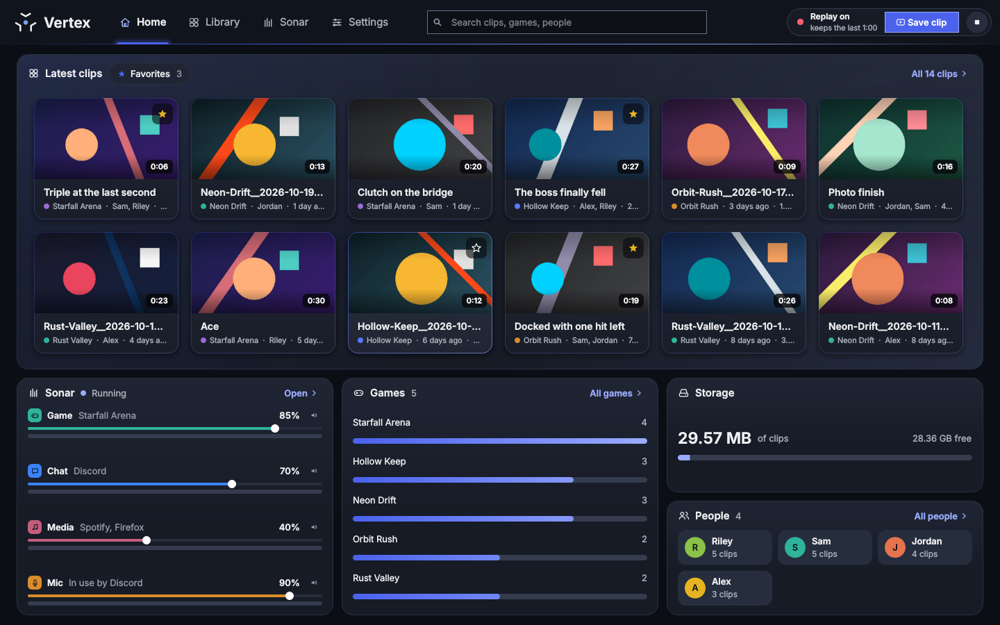
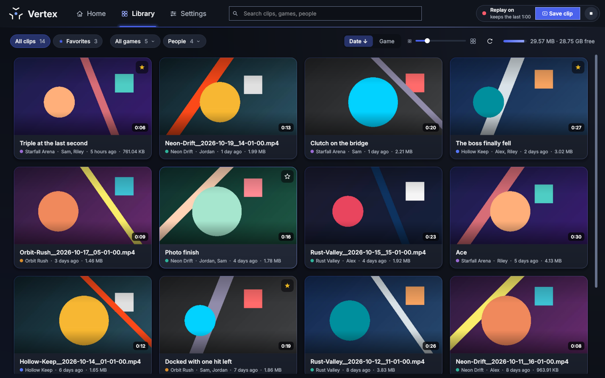
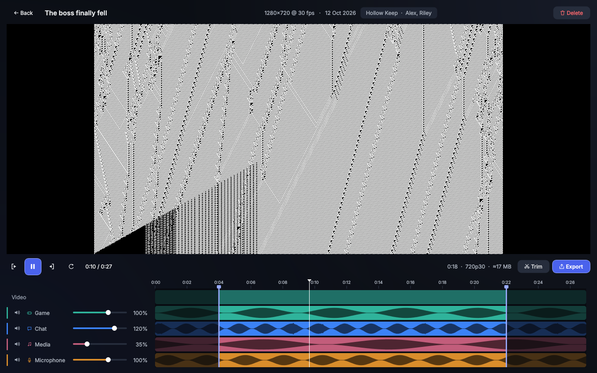
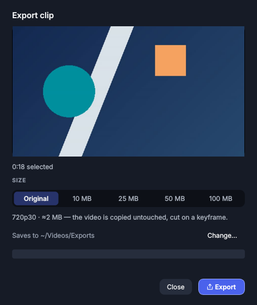
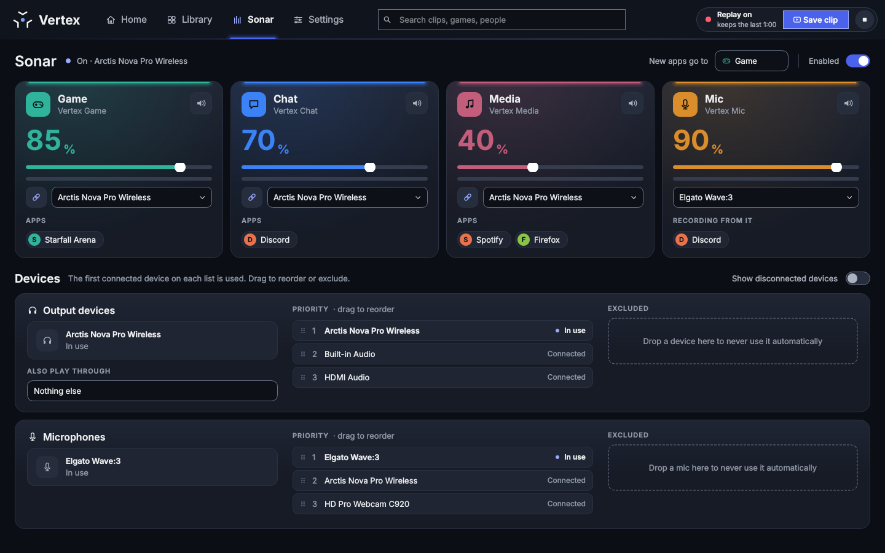
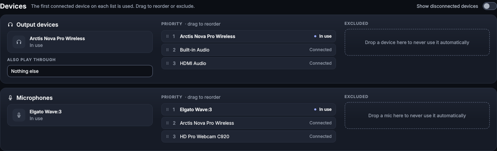
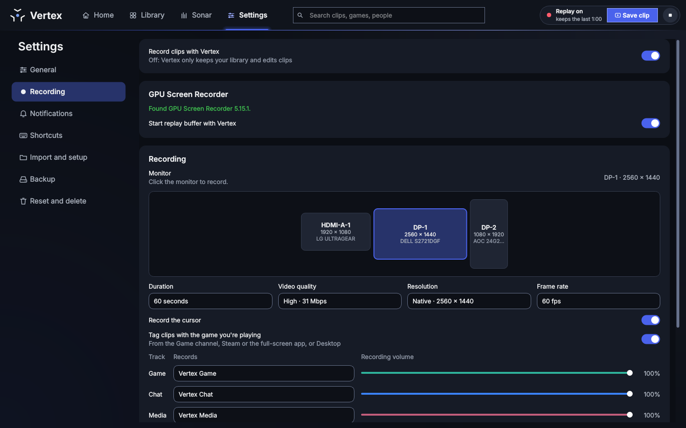
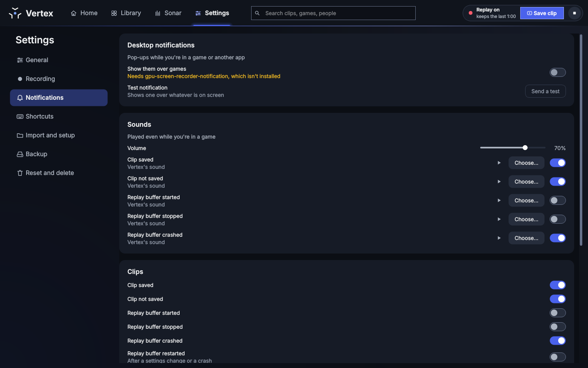
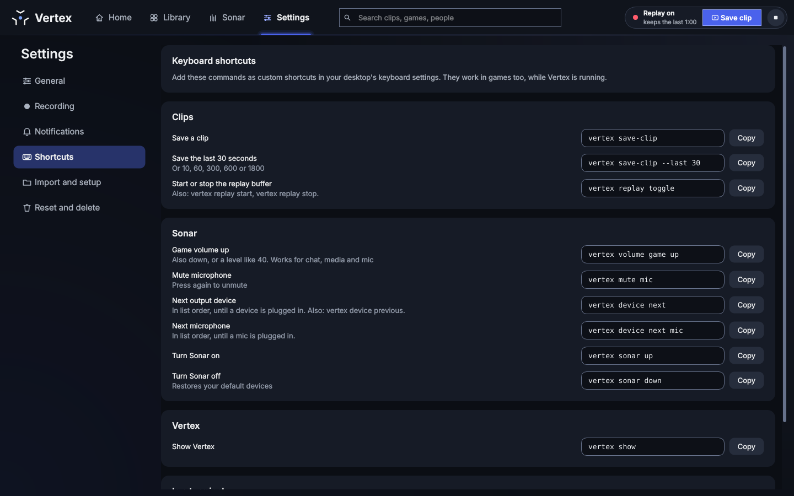
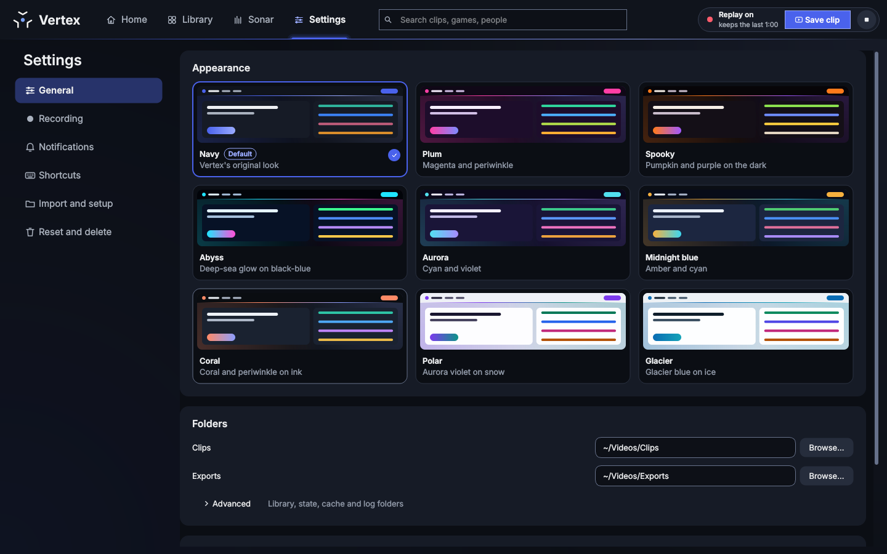

# User guide

A short tour of everything Vertex does, page by page. For installing, see the
[README](../README.md#install).

- [The top bar](#the-top-bar)
- [Home](#home)
- [Library](#library)
- [Editor](#editor)
- [Exporting and sharing](#exporting-and-sharing)
- [Sonar](#sonar)
- [Recording clips](#recording-clips)
- [Notifications](#notifications)
- [Shortcuts and the tray](#shortcuts-and-the-tray)
- [Settings](#settings)
- [Logs and troubleshooting](#logs-and-troubleshooting)

---

## The top bar

**Home**, **Library**, **Sonar** and **Settings**, a search box that covers
your whole library (Ctrl+F), and the replay buffer: whether it is on and how
much it keeps, a **Save clip** button, and a button to start or stop it.

Other keys anywhere in the window: Ctrl+1 Library, Ctrl+2 Sonar, Ctrl+,
Settings, F5 rescan the clips folder, Ctrl+Q quit.

## Home

What Vertex opens on. Your newest clips (or your favorites), Sonar's channels
with their faders, your games and the people you play with by clip count, and
how much space your clips take. Each tile links to the page with more.

## Library

Every video in your clips folder, newest first.

- **Filter** with the chips: all clips, favorites, one game, one person.
  **Sort** by date or game, either way. **Search** matches the game, people,
  title and file name; every word has to match.
- **Card size:** the slider, or Ctrl + / Ctrl − (Ctrl+0 resets it).
- **On a card:** rest the pointer on it to preview the clip. Click the title
  to rename it, the game line to tag it, the star to favorite it.
- **Right-click** (or the Menu key): open, rename, edit tags, favorite,
  quick export, show in folder, copy path, delete.
- **Keys:** arrows, Home/End and Page Up/Down move; Enter opens; F2 renames;
  F favorites; Delete deletes (to the Trash).
- **Drag** a card out of the window to drop the file into Discord, a file
  manager or a browser.

Tags: a clip has one game and any number of people. Names you used before
are offered as you type, and spellings are merged (`THE FINALS` joins
`The Finals`). Clips named the SteelSeries Moments way
(`Game-Name__2026-08-11__22-14-07.mp4`) get their game by themselves.

Clips from anywhere work: Moments, older GPU Screen Recorder setups, or any
video dropped into the folder.

## Editor

Click a clip to open it.

- **Tracks:** each audio track gets a lane with its waveform, a mute button
  and a volume slider (0 to 150%). Changes are heard straight away. Tracks
  are named after the Sonar channel they were recorded from.
- **Selection:** drag the handles at either end of the timeline, or press
  I and O at the playhead. Everything outside it is left out of trims and
  exports.
- Volumes, mutes and the selection are saved per clip as you go; the video
  file itself is never changed.

| Key | |
|---|---|
| Space, or click the video | Play / pause |
| ← / → | 5 seconds back / forward (Shift: 1 second) |
| , / . | One frame back / forward |
| I / O | Start / end of the selection at the playhead |
| Home / End | Go to the start / end of the selection |
| Double-click the video | Full screen |
| Esc | Leave full screen, or go back |

**Trim** cuts the clip to the selection without re-encoding, keeping every
track, so it can be edited again. Save it as a copy, or replace the original
(which goes to the Trash; titles, tags and the mix stay with it).
**Delete** moves the clip to the Trash.

## Exporting and sharing

**Export** mixes the tracks at your volumes into one MP4.

- **Original** keeps the video as it is. **10, 25, 50 and 100 MB** re-encode
  it to fit that size, lowering the resolution when needed so it still looks
  good.
- When it is done, **Copy file** puts the file on the clipboard: paste it
  into Discord or any upload field. Or open its folder.
- **Quick export** in a clip's right-click menu does the same in the
  background, at the size you exported at last, using the clip's saved
  selection and mix, and copies the result to the clipboard.

Exports go to the exports folder set in Settings, written under a hidden name
until they are finished, so a cancelled export leaves nothing behind.

## Sonar

Sonar gives each kind of sound its own virtual device, like SteelSeries Sonar:

| Channel | Device apps see | For |
|---|---|---|
| Game | Vertex Game | games, and any app without a rule |
| Chat | Vertex Chat | Discord, TeamSpeak, Mumble |
| Media | Vertex Media | music, videos, the browser |
| Mic | Vertex Mic | your real microphone, as one input for every app |

- **Turn it on** with the *Enabled* switch, or in first-run setup. While it
  is on, the channel new apps go to and Vertex Mic are the system defaults; turning it
  off (or quitting Vertex) removes every Vertex device and gives back your
  previous defaults.
- **Apps:** each channel lists the apps playing on it. Move an app to
  another channel and it goes there every time it plays again. *New apps go
  to* sets where apps without a rule land.
- **Volume and mute** per channel, with a live level meter.
- **Vertex Mic:** pick it as the input in Discord and other apps once. Which
  real mic feeds it is chosen in Vertex, so switching mics never means
  changing every app's settings. Muting the Mic channel mutes Vertex Mic for
  everything.
- **Which device plays it:** all output channels play through the same
  device. Unlink a channel (the chain button) to send it to its own device
  instead. *Also play through* plays the output channels on a second device
  as well, for example speakers next to a headset.

**Devices.** Outputs and microphones each have a priority list. The first
connected device on it is used; unplug it and the next one takes over; plug
it back in and it returns. Drag to reorder, or drag a device to *Excluded* so
it is never picked by itself. Picking a device on a channel, or with
`vertex device next`, is for now: it lasts until a device is plugged in or
out. *Show disconnected devices* shows the ones not plugged in.

## Recording clips

Recording uses [GPU Screen Recorder](https://git.dec05eba.com/gpu-screen-recorder/about/)'s
replay buffer: it keeps the last stretch of your screen and sound in memory
and writes a clip when you ask. It runs on the GPU, so games don't notice.

- **Start it** with the button in the top bar, the tray menu or
  `vertex replay start`, or switch on *Start replay buffer with Vertex*. If
  it crashes, Vertex restarts it once; a second crash within a minute leaves
  it off and says so.
- **Save a clip** with `vertex save-clip` bound to a key, the **Save clip**
  button, the tray menu or a Stream Deck key. `vertex save-clip --last 30`
  saves only the end of the buffer.
- New clips appear in the library by themselves. With *Auto-tag clips with
  the game* on, a clip is tagged with the app playing on Sonar's Game channel.
- **Settings › Recording:** click the monitor to record on the map; choose
  the clip length (30 seconds to 2 minutes), video quality, resolution and
  frame rate; the cursor; and which sound goes into the Game, Chat and
  Microphone tracks (Vertex's channels by default). The page shows how big a
  clip will be and how many more fit on the disk.
- **Advanced:** bitrate mode and bitrate, codec, frame rate mode, container,
  color range, GPU or CPU encoding, keyframe interval, keeping the buffer on
  disk instead of in memory, a different folder for new clips, audio codec
  and bitrate, the recorder command (for the Flatpak, for example), extra
  arguments, and a preview of the exact command Vertex runs.
- Changes on the Recording page wait for **Apply**, which restarts the
  replay buffer with them. Everything else in Settings applies straight away.
- If GPU Screen Recorder isn't installed, the page says so and offers
  *How to install it*, *Set the command* and *Check again*.

## Notifications

Vertex tells you when a clip is saved, when the replay buffer stops or
crashes, when Sonar switches devices, and when something goes wrong. Inside
the window these show as toasts. When Vertex isn't in front:

- **Show them over games** uses GPU Screen Recorder's notifier
  (`gpu-screen-recorder-notification`), which draws above fullscreen games.
  *Send a test* shows one. Without the notifier, desktop pop-ups are used.
- Each kind of notification can be switched off on its own.

## Shortcuts and the tray

Wayland desktops bind global keys themselves, so Vertex gives you commands to
bind instead. *Settings › Shortcuts* lists them with a **Copy** button each:
saving clips, the replay buffer, channel volumes, mutes, the next output or
microphone, Sonar on and off, and showing Vertex. They work while you are in
a game. Add them in your desktop's keyboard settings (see the
[README](../README.md#3-a-key-to-save-clips)).

**The tray icon** keeps Vertex running when the window is closed (unless
*Close to tray* is off). Its menu: show Vertex, open the Library or Sonar,
start or stop the replay buffer, save a clip or the last 30 seconds, switch
the output device or microphone, and quit.

For a Stream Deck there is a
[StreamController plugin](https://github.com/StellarGalaxyAtlas/vertex-streamcontroller); scripts can use the
[control API](CONTROL.md).

## Settings

- **General:** the color scheme (Navy is the default; Polar and Glacier are
  light), the clips and exports folders, and under *Advanced* the library,
  state, cache and log folders and *Keep logs*. *Close to tray* and *Start
  with your computer* (starts hidden in the tray).
- **Recording** and **Notifications:** see above.
- **Shortcuts:** commands to bind to keys, see above.
- **Import and setup:** *Import clips* copies clips from SteelSeries Moments
  or another folder into your clips folder. *Tag games from file names* reads
  the game from Moments-style names and lets you review every tag before it
  is saved. *Run setup again* starts first-run setup with your current
  settings.
- **Reset and delete:** *Reset settings* (and run setup again), *Clear
  cache* (thumbnails and previews, made again as needed), *Reset library*
  (titles, tags, favorites and edits; your video files are kept). Each asks
  first.

**First-run setup** walks through four steps: folders, Vertex Sonar (output
and input device), Vertex Moments (the recorder, monitor and clip settings,
and whether in-game notifications are available) and your library, where an
existing folder of clips can be brought along and its games tagged.

If a configured folder has been renamed or its drive isn't mounted, Vertex
says so when it starts instead of opening an empty library.

## Logs and troubleshooting

- `vertex doctor` checks that everything Vertex needs is installed and that
  the recorder settings are valid, and says how to fix what isn't.
- Logs are in `~/.local/state/vertex/logs/`: `vertex.log` (starting,
  settings changes, commands, errors), `recorder.log` (the replay buffer and
  the exact GPU Screen Recorder command and its output when it fails),
  `sonar.log` (devices, switches, volumes, app routing) and `clips.log`
  (saves, trims, exports, deletes). Each is at most 2 MB with two older
  copies. Switch them off with *Settings › General › Advanced › Keep logs*.
- Thumbnails look wrong? *Settings › Reset and delete › Clear cache*.
- On KDE Plasma under Wayland, `vertex show` asks KWin to bring the window to
  the front, since Wayland doesn't let an app raise itself.
